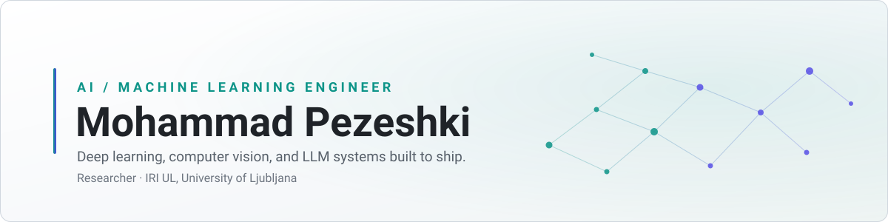

<picture>
  <source media="(prefers-color-scheme: dark)" srcset="./assets/banner-dark.svg">
  <source media="(prefers-color-scheme: light)" srcset="./assets/banner-light.svg">
  
</picture>

### Hi, I'm Mohammad 👋

I build machine learning systems and the plumbing that keeps them running — training pipelines, evaluation harnesses, and API clients that turn messy external data into something a model can actually use.

Lately I've been working on **high-energy physics classification**, reproducing the Baldi et al. (2014) deep-learning-vs-boosted-trees comparison on the UCI HIGGS dataset, and on **applied vision + LLM tooling** for plant identification and care.

I care about reproducibility. Every project here ships with pinned dependencies, a documented pipeline, and results you can regenerate from a clean clone.

 

### Selected work

| Project | What it is |
| :--- | :--- |
| **[Higgs Boson Detection](https://github.com/mohpezeshki/Higgs-Boson-Detection)** | Deep feedforward network vs XGBoost on 11M simulated collision events. Full metric breakdown — ROC AUC, AMS, calibration — plus threshold analysis showing where each model actually wins. |
| **[Plant Identifier & AI Care Assistant](https://github.com/mohpezeshki/Plant-identifier-and-ai-care-assistant)** | Image-based species identification paired with a language model that generates tailored care guidance. |
| **[LinkedIn Scraper](https://github.com/mohpezeshki/Linkedin-Scraper)** | Python client covering 45 endpoints of the Fresh LinkedIn Scraper API — jobs, profiles, companies, posts, ads, groups — with input validation on every category. |

 

### Toolbox

 

<b>A bit more about how I work</b>

 

- **Baselines before architecture.** A tuned XGBoost run tells you whether the problem is hard or your features are. It also tends to win more often than people expect.
- **Metrics that match the domain.** Accuracy hides a model that misses two-thirds of the positive class. Physics has AMS; every domain has something better than the default.
- **Reproducible or it didn't happen.** `uv.lock`, seeded runs, checkpoints, and a `main.py` that goes from raw data to plots in one command.
- **Notebooks explore, modules ship.** Exploration lives in `notebooks/`, but anything that runs twice moves into `src/`.

 

### GitHub stats

<picture>
  <source media="(prefers-color-scheme: dark)" srcset="https://github-readme-stats.vercel.app/api?username=mohpezeshki&show_icons=true&hide_border=true&theme=github_dark&icon_color=2dd4bf&title_color=818cf8">
  
</picture>

<picture>
  <source media="(prefers-color-scheme: dark)" srcset="https://github-readme-stats.vercel.app/api/top-langs/?username=mohpezeshki&layout=compact&hide_border=true&theme=github_dark&title_color=818cf8">
  
</picture>

 
 

### Get in touch

Open to conversations about applied ML, scientific computing, and anything involving a dataset large enough to be annoying.
